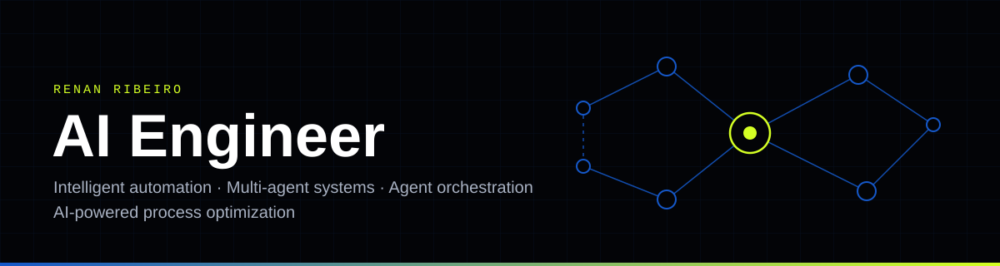

 

I design and build **AI-powered systems that solve real business-process problems**: agent platforms, orchestration layers, LLM integrations and the backend architecture that keeps them reliable, secure and measurable.

My work sits where **software architecture meets applied AI**: multi-tenant SaaS foundations, autonomous agents in the software engineering lifecycle, and API-driven automation of operational workflows.

 

## Selected Work

Case studies below are **proprietary projects**. Their repositories are private and no code, prompts, credentials or client data are published here. Public repositories are listed further down.

### AUTRIX — AI Agent Platform
`Proprietary` · `SaaS` · `Applied AI Engineering`

A multi-tenant SaaS platform for intelligent agents that automate business processes. The engineering challenge is running agents safely and economically for many tenants on shared infrastructure.

- **Agent orchestration** and execution management across tenants
- **Tenant isolation** as a core architectural constraint
- **LLM integration** with token and usage management
- **Credit-based consumption** model for metering agent work
- **Workflow automation** through API integrations

### Auctor — Autonomous Development Agent
`Proprietary` · `Agentic Software Engineering`

An agent-driven approach to automating the software engineering cycle, from a ticket to a verified deliverable.

- Integrates with **GitLab** to identify and analyze technical demands
- Plans the implementation and executes tasks through **agents, using Claude Code**
- Builds the project and runs the **test suite**
- Generates **technical documentation** and **test evidence**
- Connects to **QA workflows**

### EstagioCheck — Healthcare Management System
`Proprietary` · `Software Engineering`

A system for managing internship programs in healthcare units, applying software engineering to process management and operational automation.

- **.NET / C#** REST APIs with **Angular** front end
- **PostgreSQL** and **Supabase**
- **Authentication, authorization and role-based access control**
- Automation of recurring operational routines

 

## Public Repositories

| Project | What it demonstrates | Stack |
| :-- | :-- | :-- |
| [**IA_FIAAPI**](https://github.com/RibeiroRenan04/IA_FIAAPI)   `Academic · team project` | REST API that simplifies legal, medical and government text with an LLM. Accepts text or PDF/DOCX/TXT files, enforces a structured JSON contract, limits input size and ships as a container. | C# · .NET 8 · OpenAI API · Docker |
| [**IA_FIA**](https://github.com/RibeiroRenan04/IA_FIA)   `Academic · team project` | Angular front end for the same product: file upload with client-side validation, signal-based state, accessible UI, deployed to production. | Angular · TypeScript · Vercel |
| [**AutoTria**](https://github.com/RibeiroRenan04/AutoTria)   `Academic` | AI triage of contact messages with a low-code workflow: input validation before the model, graceful fallback to manual review, prompt-injection guard and a documented test suite. | Make · Airtable · LLM prompting |

 

## Engineering Focus

| | |
| :-- | :-- |
| **Multi-Tenant Architecture**   Isolation, shared infrastructure, per-tenant control | **Multi-Agent Orchestration**   Coordinating agents, execution state and hand-offs |
| **AI Workflow Engineering**   Turning business processes into reliable agent flows | **LLM Integration**   Structured outputs, guardrails, failure handling |
| **Context Management**   What the model sees, and when | **Token Consumption Management**   Usage tracking and credit-based metering |
| **API-Driven Architecture**   Clear contracts between services and integrations | **Authentication & Authorization**   Identity, roles and access boundaries |
| **Process Automation**   Replacing manual operational routines | **Scalable SaaS Systems**   Designed to grow without redesign |

 

## Stack

| | |
| :-- | :-- |
| **AI Engineering** |      |
| **Backend** |    |
| **Frontend** |    |
| **Data** |   |
| **Tools** |    |

<!--
PENDING CONFIRMATION — add only what you can back with real project experience:
LangChain, RAG, Tool Calling, MySQL, SQL Server, Pandas, NumPy, Plotly, Scikit-learn, CI/CD
-->

 

## Education & Certifications

**Education**
- B.Sc. in Computer Science, UDF — *in progress*

**Certifications**
- Oracle Cloud Infrastructure 2025 Certified AI Foundations Associate
- Foundational C# with Microsoft
- Cisco Networking Academy — Introduction to Data Science
- Cisco Networking Academy — Python Essentials 1

 

## Let's Connect

<!-- PENDING: add LinkedIn and professional email after confirmation

-->

 

Public GitHub activity (private and proprietary work is not reflected)

 

